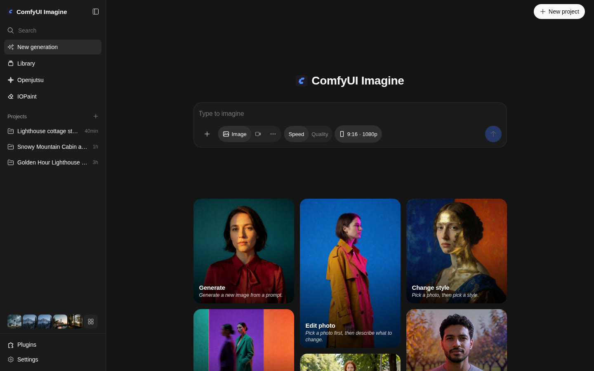
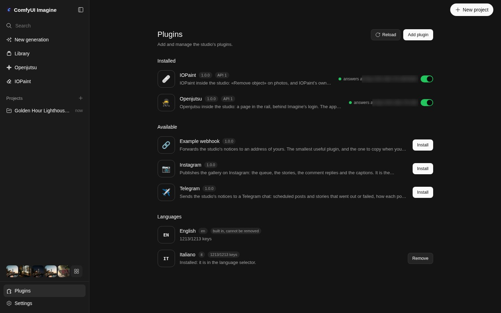

<p align="center">
  
</p>

<h1 align="center">ComfyUI Imagine</h1>

<p align="center">
  A local studio for ComfyUI: describe what you want, get images, edits and videos.
</p>

<p align="center">
  <a href="LICENSE"></a>
  
  
  <a href="https://github.com/BTekV4/comfyui-imagine/releases/latest"></a>
  <a href="https://github.com/BTekV4/comfyui-imagine/actions/workflows/ci.yml"></a>
</p>

<p align="center"><sub>An independent project for ComfyUI, not affiliated with or endorsed by Comfy Org.</sub></p>

<p align="center">
  
</p>

<p align="center">
  
</p>

<p align="center"><sub>Six of the recipes, in motion — every frame rendered by the studio itself.</sub></p>

A chat that turns a sentence into the right graph, a queue that runs it, a
canvas and a gallery, and a set of ready-made recipes — image to video, character
and object swap, relighting, animated loops, music, voice, upscaling.

It is a single Node process plus a React interface. It talks to ComfyUI over its
HTTP API and to any OpenAI-compatible chat-completions endpoint for the text and
vision work. Nothing leaves your machine except the calls to the model endpoint
you configure.

The interface is written in English; other languages are installable packs, and
the repository ships Italian (see [Languages](#languages)).

## Start here

Two things to know before anything else: **the weights are not in this
repository** (the studio downloads the ones an action needs, after asking), and
**ComfyUI is where the rendering happens** — it can be on the same machine or
another one on the network, and the studio only talks to it over HTTP.

What a fresh install pulls, per kind of work — so you can tell at a glance
whether this is the project for your card:

| You want | Weights | ComfyUI can run it on |
|---|---|---|
| Photos: generate, edit, style, background, upscale | about 22.6 GB (Krea 2 + the pack) | 16 GB of VRAM, comfortably |
| A person from a reference photo (compose) | + 17.3 GB | 16 GB |
| Relight | + 5.6–6.2 GB | 16 GB |
| Music | 14.3 GB | 16 GB |
| Video (MiniMax H3), any length | 76–88 GB | 24 GB, and patience: a clip is minutes, not seconds |

The first request that needs something ComfyUI does not have offers to install
it: node packs at the version this studio was tested with, weights checked file
by file. Nothing is downloaded before you say yes, and everything can be
declined — the action then says what it would have needed.

**Download for your system and double-click.** Node and ffmpeg are inside the
packages, so there is nothing to install first:

| Your system | Download | Then |
|---|---|---|
| **Windows** (64-bit), the app | `Imagine-<version>-windows-x64-setup.exe` | double-click it: the installer puts Imagine on the Desktop and in the Start menu, then opens it |
| **Linux** (64-bit), one app | `Imagine-<version>-linux-x64.AppImage` | double-click it: Imagine opens in its own window |
| **Linux**, a folder you keep | `Imagine-<version>-linux-x64.zip` | extract it, run **Imagine.sh** (`bash Imagine.sh`, or double-click it) |
| **macOS**, or a server | `comfyui-imagine-<version>.tar.gz` | `tar xzf … && cd … && ./install.sh` |

The Windows installer is **per user** (no administrator password), keeps your
data in `%APPDATA%\Imagine`, and is **not signed yet**: the first time,
Windows shows a warning — **More info → Run anyway** clears it, see
[The app (Windows)](#the-app-windows).

In the Linux and macOS zips the launcher opens the browser by itself, and a
second double-click just reopens the page instead of starting a second copy.
On the first start there is **no configuration to write**: the studio creates
one (ComfyUI on `127.0.0.1:8188`), and the home page's **first-run card** says
what is still missing — ComfyUI not answering, no text model, no ffmpeg — with
the setting that fixes each row. The ComfyUI address and the text model are set from that
card or from **Settings**.

That is the short version; [Install](#install) has the macOS and server paths,
Docker, the from-source checkout, and how updates work.


## What it does

- **Chat that drives the graphs.** You describe what you want; the studio picks
  an action, stages the files you dropped in, and asks the text model to write
  the prompt for that specific graph.
- **Recipes, not single nodes.** "Recreate" reads a video with the vision
  model, redraws its opening frame and renders the clip again from it. "Edit
  object" tracks an object in a clip and changes, removes or adds it;
  "Character swap" puts the person of a photo in place of the clip's main one.
- **Long videos as one take, the way [Openjutsu](#acknowledgements) does it.**
  Past six seconds a clip is a chain of scenes of at most six seconds, rendered
  inside ComfyUI with the
  [MiniMax H3 Context Loop](https://github.com/ethanfel/ComfyUI-MiniMaxH3-Context-Loop)
  nodes: each scene starts from the last frames of the one before, every scene
  is saved as a checkpoint so a stopped run resumes where it was, and the vision
  model writes one prompt per scene. Make video, extend (up to 60 s), animated
  loops (the last scene lands back on the first frame) and both swaps work this
  way; the swaps render at 480p, 720p or 1080p.
- **Ready-made models, one form each.** Sixteen templates in the home page's
  grid, mixed in with the workflow cards and filtered by the same chips (All,
  Photo, People, Product, Video, Graphics, Audio): photo edit, background,
  headshot, profile picture, restyle, product
  colour, smart resize, collage, e-commerce set, UGC photos, editorial poster,
  icon maker, emoji pack, mascot, character sprite, hero reveal. Fill in the
  few fields the model asks for and the studio queues the runs it needs — one
  per choice, one per style, each chained into what has to happen to its
  result (cut the subject out of every emoji, put the still on the ratio you
  asked for). Collages and resizes are composed with ffmpeg, with no AI in the
  middle.
- **A job queue that survives.** Long renders report progress, can be cancelled,
  and a music video left half-made is picked up again after a restart.
- **A photo viewer with tools.** Every picture opens with **Segments** (each
  object found, cut out, ready to edit or download), **Precise edit** with a
  brush, **Colors**, **Draw** and **Crop**, plus one-click remove background,
  make video and upscale.
- **Graphs as configuration.** Every action is an API-format ComfyUI graph plus a
  handful of node ids in `config.yaml`. Swap the model, keep the studio.
- **An MCP server.** `mcp/` exposes the studio's projects, files and jobs as
  typed tools for MCP clients (Claude Code and other agents). It is a separate
  process that talks to the studio only through its HTTP API — see
  [mcp/README.md](mcp/README.md). The home page's sixteen models are there too
  (`imagine_templates`, `imagine_run_template`), so an agent can read a form
  and run it with gallery files.

## Screenshots

| | |
|---|---|
|  |  |
| **Project** — the chat explains each choice; results land on the canvas | **Canvas** — arrange, compare and reuse what the project made |
|  |  |
| **Media** — everything in one grid: search, filter, start from any of it | **Viewer** — Segments finds the objects in a photo to edit one by one |
|  |  |
| **Library** — everything you made, by project | **Plugins** — optional features and language packs, installed from the page |

## Supported models

What `config.example.yaml` wires to each action, read from the graphs in
`workflows/`. The file names are the ones the graphs load: put the weights in
the matching ComfyUI folders, or edit the graph to use your own. Any action can
point at another graph — see [The workflows](#the-workflows).

| Action | Model family | Weights the graph loads |
|---|---|---|
| Generate image, redraw a video's first frame | **Krea 2 Turbo** ([Comfy-Org/Krea-2](https://huggingface.co/Comfy-Org/Krea-2)) | `krea2_turbo_int8_convrot` (or `krea2_turbo_nvfp4` on an RTX 50), text encoder `qwen3vl_4b_int8_convrot`, VAE `qwen_image_vae` |
| Edit photo, precise edit (brush), reference image | **Krea 2 Turbo** + identity-edit LoRA | the three above + `krea2_identity_edit_v1_2` (LoRA) |
| Compose a person with a reference (costume, setting) | **Qwen-Image 2.1** | `qwen_image_2.1_int8_convrot`, `qwen3vl_8b_int8_convrot`, `qwen_image_2.1_vae_bf16` |
| Relight a photo | **FLUX.3 Klein** | `flux3-image-klein-int8-convrot` ([black-forest-labs](https://huggingface.co/black-forest-labs/flux-3-image-klein-comfy), gated), `qwen3vl_4b_int8_convrot` (the Krea 2 text encoder), `flux2-vae` |
| Make video, loop, extend, video on a song, recreate video (chained scenes past 6 s) | **MiniMax H3** + Pika H3 Flex LoRAs | `minimax_h3_fl2va` / `minimax_h3_ref2va` (int8), text encoder `qwen3vl_32b_minimax_h3_nvfp4_awq`, video and audio VAEs; the Pika adapters: `pika_h3_flex_turbo_4step_{fl2va,ref2va}` (fast recipe, 4 steps) and `pika_h3_flex_{fl2va,ref2va}_v1_bf16` (quality recipe, 6 steps) |
| Edit object in a video: change, remove, background, add; character swap (lip-sync on or off) | **MiniMax H3** + **SAM 3.1** + Qwen3-VL 8B (describer) | `minimax_h3_ref2va` + the DMAD 4-step LoRA ([Kijai/MiniMax-H3-experimental](https://huggingface.co/Kijai/MiniMax-H3-experimental)) at 6 steps, `sam3.1_multiplex_fp16` — the masked-edit recipe Openjutsu uses |
| Regenerate detail (video at 1.5×) | **MiniMax H3** | latent upscaler 3D + `minimax_h3_open_regenerate_2k` LoRA |
| Segments (objects in a photo) | **SAM 3.1** + the vision model | `sam3.1_multiplex_fp16`, node in [comfyui-nodes/comfyui-imagine](comfyui-nodes/comfyui-imagine) |
| Upscale photo / video | **SeedVR2** | `seedvr2_7b_sharp_int8_convrot` (photo), `seedvr2_3b_int8_convrot` (video), `ema_vae_fp16` — ComfyUI's native SeedVR2 nodes, NVFP4 builds on an RTX 50 ([Comfy-Org/SeedVR2](https://huggingface.co/Comfy-Org/SeedVR2)) |
| Remove background | **BiRefNet** | `birefnet` |
| Music | **MiniMax Music 3** | `minimax_music3_dit_fp16`, its text encoder and `minimax_music3_dav` |
| Change voice / extract vocals | **RVC** / **MelBand RoFormer** | your `voice-model.pth`; `MelBandRoformer_fp16` |
| Remove object (photo) | **LaMa** in IOPaint | through the IOPaint plugin, outside ComfyUI |

Two notes on the video rows: the Pika LoRAs are adapters on top of MiniMax H3,
not a separate model ([Pika-Labs/Pika-H3-Flex](https://huggingface.co/Pika-Labs/Pika-H3-Flex),
[Pika-H3-Flex-Turbo-LoRA](https://huggingface.co/Pika-Labs/Pika-H3-Flex-Turbo-LoRA)),
and the ComfyUI builds of them come from
[Comfy-Org/MiniMax-H3](https://huggingface.co/Comfy-Org/MiniMax-H3).

**Installed for you:** every action that runs in ComfyUI except the two voice
ones. With the
[comfyui-imagine](#the-comfyui-pack) pack in ComfyUI, the first request that
needs them downloads the weights above from Hugging Face and the node packs
they use:

- Krea 2, Segments, Remove background: about 22.6 GB. On an RTX 50 (Blackwell)
  it takes the NVFP4 build of Krea 2 instead: 7.7 GB rather than 13.5, and on
  an RTX 5070 Ti about 11% faster with 3.5 GB less VRAM at the same quality.
- MiniMax H3 video: about 76 GB with the NVFP4 text encoder on an RTX 50, or
  about 88 GB with the INT8 one on other cards; each action downloads only the
  files it uses.
- Music: about 14.3 GB.
- Compose (Qwen-Image 2.1): about 17.3 GB.
- Relight (FLUX.3 Klein): about 5.6 GB on an RTX 50 (NVFP4), 6.2 GB on other
  cards, on top of the Krea 2 text encoder. Its
  weights are in a **gated** repo: accept the licence on
  [its page](https://huggingface.co/black-forest-labs/flux-3-image-klein-comfy)
  with your Hugging Face account and put a token of that account in
  Settings → ComfyUI setup; without one, the chat says so before anything is
  downloaded.
- Upscale: photo 4.8 GB on an RTX 50 (8.3 GB on other cards), video 2.0 GB
  (3.5 GB), plus a 0.5 GB VAE; long videos also use Video Helper Suite.

Most of the H3 node packs are marked **Flagged** in the Comfy Registry, and a
few come straight from GitHub because the registry does not carry them. Imagine
installs them only at the exact version it was tested with, checked file by
file, and always asks first, even with **Install automatically** on: the chat
card says where each pack comes from. A version the registry has banned is
never installed.

Change voice and Extract vocals still go in by hand: they need
[TTS Audio Suite](https://github.com/diodiogod/TTS-Audio-Suite), a large pack
with many dependencies, and Change voice runs your own RVC voice model.

**Text and vision** go to any OpenAI-compatible chat-completions endpoint
(Ollama, vLLM, LM Studio, llama.cpp, a hosted API): the model writes the
prompts, reads photos and frames, and names projects. One with image input is
recommended — Segments, Recreate and the photo descriptions need it.

## Requirements

- Node 24 or newer (`package.json` declares `"engines": { "node": ">=24" }`).
- `git`, to get the code and to update it.
- `ffmpeg` and `ffprobe` on the `PATH`: thumbnails, crops, trims and every
  video step use them (`apt install ffmpeg` on Debian/Ubuntu).
- A reachable ComfyUI (0.45 or newer) with the **comfyui-imagine** pack — see
  [The ComfyUI pack](#the-comfyui-pack). It installs the models and nodes of the
  Krea 2 actions by itself; for the other actions, the custom nodes and weights
  their graphs name go in by hand. **Weights are not included in this repository.**
- An OpenAI-compatible endpoint for text, and ideally one that takes images.

### What it will download, and where

Nothing in the table above is bundled: the studio fetches the weights an action
needs from Hugging Face, with the URLs and the sizes written in the ComfyUI
pack's `manifest.json`, and every file checked by SHA-256. The files land in
ComfyUI's own folders (`models/diffusion_models`, `models/text_encoders`,
`models/vae`, …), so they are shared with everything else that ComfyUI runs. A
gated repository (FLUX.3 Klein) needs a Hugging Face token in
**Settings → ComfyUI setup**, and the chat says so before downloading.


## Install

### The app (Linux)

`Imagine-<version>-linux-x64.AppImage` is the studio as a desktop app: one file,
double-click, and **Imagine opens in its own window** — the studio inside, its
own icon, and a menu. No browser and no terminal. The window starts the studio's
server on a free loopback port and stops it when you close the window; if you
double-click the file a second time, the window that is already open comes to
the front instead of a second copy starting.

**The program and your data are separate.** The AppImage is mounted read-only:
the program (the server, the page, the graphs, the language packs) is replaced
whole when you update the file, and the new version finds your data again —

| What | Where |
|---|---|
| `config.yaml`, the media, the projects, the installed plugins and languages | `~/.config/Imagine` |
| the log, and a copy of `config.example.yaml` | `~/.config/Imagine/logs`, `~/.config/Imagine` |

`IMAGINE_DATA=<folder>` puts everything somewhere else. A machine that used the
previous AppImage keeps `~/.local/share/imagine/app`, so an update finds the
configuration, the projects and the media exactly where they were.

What a failure looks like: a window, not a terminal. A studio that cannot start,
a `config.yaml` line it cannot read, a ComfyUI that does not answer (the
first-run card, as in every package) — the window says what it is and offers
**Try again**, **Open log folder** and **Open data folder**. The same two folders
are in the **File** menu, next to **Restart studio**.

The graphs an action runs come with the program, so a new version can improve
them. Change one from **Settings → Workflow** and the change goes into a copy in
your data folder (`workflows/`): from then on that copy wins — updates included
— and the card says so, with **Restore default** to throw the copy away and get
the program's graph (and its updates) back. The workflows you add yourself
already live in the data folder and are never touched by an update.

It needs `libfuse2` (Debian/Ubuntu: `apt install libfuse2`). Without it the
kernel cannot mount it and the file answers *"dlopen(): error loading
libfuse.so.2"*: run it as
`./Imagine-<version>-linux-x64.AppImage --appimage-extract-and-run`, or use the
zip, which needs nothing.

### The app (Windows)

`Imagine-<version>-windows-x64-setup.exe` installs Imagine for the user who
runs it: **no administrator prompt and no folder to choose**. Double-click it,
wait for the bar and leave **Run Imagine** checked — the window opens. There is
an icon on the Desktop and one in the Start menu, and Imagine appears in
**Settings → Apps → Installed apps** (Windows 10: **Apps & features**), where
the same entry uninstalls it.

**The first time, Windows will be suspicious.** The installer is not signed —
a code-signing certificate is a purchase, not a line of code — so SmartScreen
shows *"Windows protected your PC"*. Click **More info** (Italian: *Ulteriori
informazioni*) under the message, then **Run anyway** (*Esegui comunque*). It
asks once per downloaded file; an *"Unknown publisher"* line under the
installer's name is the same thing, and it is why the installer is checked by CI
and its `sha256` published beside it.

The program and your data are separate, exactly as on Linux:

| What | Where |
|---|---|
| the program — replaced, never edited | `%LOCALAPPDATA%\Programs\Imagine` |
| `config.yaml`, the media, the projects, the installed plugins and languages | `%APPDATA%\Imagine` |
| the log, rotated at 5 MB | `%APPDATA%\Imagine\logs\imagine.log` |

Installing a new version **over** the old one replaces the program and finds the
data where it was. Uninstalling removes the program, the shortcuts and the entry
in *Installed apps* and **leaves `%APPDATA%\Imagine` alone** — delete that
folder by hand only if you want an empty studio. `IMAGINE_DATA=<folder>` puts
everything somewhere else.

**ffmpeg and ffprobe are inside the package** (`resources\ffmpeg`) and are used
before anything else on `PATH`; Node is the one Electron carries. There is
nothing else to install: no Node, no ffmpeg, no terminal. The window behaves
like the Linux one — one instance at a time, closing it stops the studio, the
server's failures are shown in the window, and **File → Restart studio** brings
it back without closing the window.

### The portable package (Linux)

`Imagine-<version>-linux-x64.zip` is the studio with **Node 24** and a static
**ffmpeg** beside it, plus `Imagine.sh`. Windows is the installer above, not a
zip; the zip's Windows launcher in `scripts/package-portable.sh` stays a
development tool. The macOS launcher ships only once it has been run on a Mac:
a package nobody booted is not a package.

Nothing is asked in a terminal: the server writes `config.yaml` on its first
start, from `config.example.yaml` shipped beside it, with ComfyUI on
`127.0.0.1:8188` and a local text endpoint; the page's first-run card tells you
what is still missing and how to fix it. Everything the studio keeps (projects,
thumbnails, plugins, language packs, media) lands in `data/` beside the app, so
the folder is self-contained: move it, copy it to a USB stick, delete it.

The zips are built in CI on their own platform, and each one is booted there
before it is attached to the release — a package that cannot start does not
ship.

### The release tarball

Every [release](https://github.com/BTekV4/comfyui-imagine/releases) ships the
studio already built — the page, the server, the plugin bundles, and `yaml`,
the one package the launchers read the config with — so there is no
`npm install` and no build step on your
machine, and nothing to compile if your Node is not a compiler.

The file name carries the version, so the command asks the release page which
version is the latest one instead of hard-coding a number here:

```sh
VERSION=$(curl -fsSL https://api.github.com/repos/BTekV4/comfyui-imagine/releases/latest \
  | sed -n 's/.*"tag_name": *"v\([^"]*\)".*/\1/p')
TARBALL=comfyui-imagine-$VERSION.tar.gz
curl -LO "https://github.com/BTekV4/comfyui-imagine/releases/latest/download/$TARBALL"
curl -LO "https://github.com/BTekV4/comfyui-imagine/releases/latest/download/$TARBALL.sha256"
sha256sum -c "$TARBALL.sha256"
tar xzf "$TARBALL"
cd "comfyui-imagine-$VERSION"
./install.sh
node dist/server.mjs
```

(With the GitHub CLI installed, `VERSION=$(gh api repos/BTekV4/comfyui-imagine/releases/latest -q .tag_name | sed 's/^v//')`
asks the same question; `sha256sum -c` is `shasum -a 256 -c` on macOS.)

`install.sh` checks Node 24 or newer, `ffmpeg`/`ffprobe` and the ComfyUI address
it is given, asks three questions (ComfyUI's address, the OpenAI-compatible text
endpoint, the model id), writes `config.yaml` and prints the next command. Its
options:

| | |
|---|---|
| `./install.sh --check` | only run the checks, write nothing |
| `./install.sh --systemd` | also install and start `imagine.service` (as root) |
| `IMAGINE_COMFY_URL=… IMAGINE_LLM_BASE_URL=… IMAGINE_LLM_MODEL=… ./install.sh` | answer the questions without a terminal |

It never installs Node or ffmpeg itself: it names the command for your system,
because a script that starts changing a machine it has never met is a script
people stop trusting.

A fresh installation that is missing something does not look broken: the home
page shows a **first-run card** listing what is wrong — ComfyUI not answering at
the address in the file, no `ffmpeg`, no model configured, an output folder that
cannot be written — with the command that fixes each row, and it disappears when
they are all in place.

### Docker

The studio is one Node process with `ffmpeg` beside it; ComfyUI stays where it
already runs (the container talks to it over HTTP, and that is the only sane
split: the GPU and the weights are ComfyUI's). From a clone of this repository:

```sh
cp config.example.yaml config.yaml   # or run ./install.sh first, which writes one
docker compose up -d --build
```

`docker compose` builds the image from source (Node 24, `npm ci`, `npm run
build`, then a runtime image with `ffmpeg`), mounts `config.yaml` read-only and
keeps everything the studio writes in `./data`. In the container, ComfyUI on the
same machine is `http://host.docker.internal:8188` (the compose file maps that
name); on another machine, its LAN address.

### From source

For development, or when you want to read and change the code:

```sh
git clone https://github.com/BTekV4/comfyui-imagine.git
cd comfyui-imagine
npm install
cp config.example.yaml config.yaml     # then edit it: ComfyUI's address, your model endpoint
npm run build
node dist/server.mjs
```

`npm run build` runs `scripts/build.mjs`, which bundles the server
(`dist/server.mjs`), the MCP server (`dist/imagine-mcp.mjs`) and the TypeScript
plugins (`plugins/<id>/index.mjs`) with esbuild, then `vite build web` builds
the page into `dist/web`. Each part also builds alone: `npm run build:server`,
`build:mcp`, `build:plugins`, `build:web`. `npm test` runs the suite;
`npm run release:tarball` builds the tarball a release ships.

### Updating

Download the new installer and run it over the installed one (Windows), replace
the AppImage file (Linux), or replace the folder with the new release's tarball,
or `git pull` in a source checkout, then `npm install` (source only), `npm run
build` (source only) and a restart. `config.yaml`, `<data>` and your model
weights are outside all of it and stay where they are. The plugins you installed are brought up to the new
version at the next start (the old files stay beside them as
`*.bak-<time>-update`; their settings are never touched).

### The ComfyUI pack

`comfyui-nodes/comfyui-imagine` is the one thing to copy into ComfyUI by hand:

```sh
cp -r comfyui-nodes/comfyui-imagine /path/to/ComfyUI/custom_nodes/
# restart ComfyUI
```

It brings the nodes the studio's graphs use (Segments, the precise-edit crop and
stitch, lossless WebP/PNG saving) and the **setup** the studio asks before every
run. When a request needs a node pack or a model ComfyUI does not have, the chat
says what and how much, and asks **Install**; then it shows the download, restarts
ComfyUI if a node pack came in, and the same request goes on. Only what the
pack's `manifest.json` lists can be installed, each file checked by SHA-256.

In **Settings → ComfyUI setup**: **Install automatically** skips the question,
and a **Hugging Face token** is used for models that need an account (none of the
current ones do). Details in [the pack's README](comfyui-nodes/comfyui-imagine/README.md).

**There is no login until you turn it on.** Whoever reaches the address gets
in, so on a shared network set a password in **Settings → Access** and switch on
**Ask for the password**. It works over plain `http://` too; behind an HTTPS
reverse proxy the login cookie is also marked `Secure` (the proxy must send
`X-Forwarded-Proto`, as nginx and Nginx Proxy Manager do). The page warns while
the studio listens on a non-loopback address with the login off.

**Behind a reverse proxy, check the loopback bypass.** Requests that appear to
come from this machine (a loopback address and no `X-Forwarded-For`) skip the
password. A proxy **on the same machine** that does not add `X-Forwarded-For`
makes every visitor look local, and then the login protects nothing. nginx and
Nginx Proxy Manager add it by default; a proxy that strips it does not. A proxy
on another host is not affected. `trustedProxies` only decides whose
`X-Forwarded-For` the brute-force brake believes, not this bypass. What is
protected, and how to report a problem, is in [SECURITY.md](SECURITY.md).

The files live in two places:

| Where | What |
|---|---|
| Paths in `config.yaml`, read relative to that file (`./data/…` in the example) | the media the studio makes (`toolComfy.outputDir`), the password hash (`passwordFile`) and the cookie secret (`secretFile`) |
| `<data>`: `$IMAGINE_HOME`, or `~/.imagine` when the variable is not set | projects, likes and tags, thumbnails, installed plugins and language packs, custom workflows, custom covers, and the settings the page writes |

Back up both. Pointing `toolComfy.outputDir` inside `<data>` keeps everything
in one folder.


## Configuration

Everything deployment-specific lives in `config.yaml` — no address, path or
model name is compiled into the code, and every path in it is read relative to
the file itself. The keys, the persona and where the files land are in
[docs/configuration.md](docs/configuration.md); `config.example.yaml` is the
same thing with the current values filled in.

## The workflows

`workflows/` holds the graphs in ComfyUI's API format and
[workflows/README.md](workflows/README.md) lists every file and the action it
serves. [docs/workflows.md](docs/workflows.md) explains how a graph is wired to
an action, how a fast and a quality recipe share one file, and what to change to
point a recipe at your own weights.

## The templates

The sixteen models of the home page live in `shared/imagine-templates.ts`: the
fields a form asks for, the runs of each model, and the expansion that turns
answers into runs. [docs/templates.md](docs/templates.md) explains the shape, the
chains, and the two runs that are composed by ffmpeg instead of a model.

## The home covers

The cards on the home page come with covers made with the studio itself, from
invented subjects (`web/public/imagine/`). To use your own, pick an action in
**Settings → Workflows** and choose a file under "Cover for this action" (an
image or a short video), or put files named after the card's key into
`<data>/covers/` (for example `<data>/covers/video.webp`). Your covers live in
the data directory, win over the shipped ones, and updates do not touch them.

## Languages

| Language | Code | How |
|---|---|---|
| English | `en` | built in, the source of every text |
| Italian | `it` | pack shipped in `locales/it.json`, installed from **Plugins → Languages** |

A new language is one JSON file of the same keys — translate as much as you
like, the rest reads English. Packs for more languages are very welcome as
pull requests.

English is the source language: it is compiled into the page and is the
fallback for any key a pack leaves out. Every other language is a pack — one
JSON file — installed at runtime; see
[docs/language-packs.md](docs/language-packs.md). The `locales/` folder holds the
packs this repository ships (Italian, `locales/it.json`); the Plugins page
installs them.

A browser that has never chosen a language starts in the first of its own
languages that the installation has (English, or an installed pack), else in
English. To change the language,
pick one in **Settings → Language** (the choice is kept in a cookie and in the
browser's storage), or open the page with `?lang=en` (any installed code works).

The server writes its own texts (errors, notices composed in the background)
in the language of the page that asked, and otherwise in the installation's base
language: `language:` in `config.yaml`, `en` by default (`it` is the other one
the server speaks).

## Plugins

Extra features are plugins, installed as a folder under `<data>/plugins/<id>/`
with a `manifest.json` and an `index.mjs`. The studio with no plugins is the
studio as described in this file: no route, no section in the settings page, no
timer. A plugin declares its settings in the manifest and the settings page draws
them, so adding one needs no change here.

The base studio has no social side at all: publishing to Instagram and the
Telegram alerts are plugins too, in `plugins/instagram/` and `plugins/telegram/`,
and `plugins/example-webhook/` is the small one to copy. The page **Plugin** in
the rail lists what is installed (with a switch each), what could not load, and
what the repository ships and the data folder does not have — with an Install
button, so installing one needs no terminal.

`plugins/openjutsu/` and `plugins/iopaint/` show two separate web apps inside the
studio (and IOPaint also powers **Remove object**). The apps are not part of this
repository: install and run them on their own, then enter their address in the
plugin's settings. Their READMEs say what each one needs.

`docs/plugin-api.md` is the contract: manifest fields, the `ctx` a plugin is set
up with, routes under `/plugin/<id>/`, the tick and the status, how settings are
stored and validated, and what happens when a plugin is broken. A plugin can be
plain `.mjs` or TypeScript: `npm run build:plugins` bundles `plugins/<id>/src/`
into the `index.mjs` the host loads, inlining the host modules it imports.

## Status

This is a working studio published as-is, not a framework. The graphs are tied to
specific model families (Krea 2 for images, MiniMax H3 for video; Qwen-Image,
FLUX.3 Klein, SeedVR2 and MiniMax Music for single actions) because
that is what the recipes were measured on. Other families work if you write the graph.

## When it is not for you

Say it early, so nobody installs 22 GB to find out:

- **You want to build graphs by hand.** ComfyUI itself does that better: the
  studio picks the graph. It is a front door, not an editor — you can point an
  action at your own graph, but you will not wire nodes on a canvas here.
- **You have 8 GB of VRAM.** Photos start at about 16 GB comfortably; the video
  recipes want 24 GB and minutes per clip.
- **You need Windows signing or a support contract.** The installer is not
  signed yet, and this is a project, not a product: answers come when they come.
- **You want a cloud service.** Nothing runs outside your machine except the
  calls to the text model you configure; there is no hosted version and no
  account to create.
- **You want a model zoo.** A handful of families are wired, deliberately. A new
  one is a graph and an adapter, not a checkbox.

## Requests, ideas and help

Bug reports and ideas go to
[issues](https://github.com/BTekV4/comfyui-imagine/issues) — there is a form for
each, and it asks for the version and the log, which is what makes a fix
possible. Questions, half-formed ideas and "how do I…" belong in
[Discussions](https://github.com/BTekV4/comfyui-imagine/discussions), where the
[roadmap thread](https://github.com/BTekV4/comfyui-imagine/discussions/categories/ideas)
collects what to build next and the votes for it. What you made with the studio
is welcome in **Show and tell**.

## Contributing

Help is welcome — see [CONTRIBUTING.md](CONTRIBUTING.md) for how to run it in
development, the tests, and the few rules the code follows. Bugs and ideas go to
the [issue forms](https://github.com/BTekV4/comfyui-imagine/issues/new/choose);
questions and what to build next live in
[Discussions](https://github.com/BTekV4/comfyui-imagine/discussions).

## Acknowledgements

Imagine was built with a lot of help, and it shows in the code and in the studio:

- **[Claude](https://www.anthropic.com/claude)** (Anthropic) — pair programmer for
  most of the code, the reviews and the tests.
- **[Grok](https://grok.com)** (xAI) — Grok Imagine is the model for the studio's
  look and flow: the canvas, the photo viewer and its tools, Segments.
- **[DeepSeek](https://www.deepseek.com)** — the studio started inside DeepSeek
  Harness (see `NOTICE`), and DeepSeek models drive its chat.
- **[Qwen](https://qwen.ai)** (Alibaba) — Qwen-Image and the Qwen3-VL text and
  vision encoders behind Krea 2, MiniMax H3 and FLUX.3 Klein in these graphs.

- **Openjutsu**, **[D3voz's one-click swap nodes](https://github.com/D3voz/comfyui-h3-oneclick-swap)**
  and **[ethanfel's MiniMax H3 Context Loop](https://github.com/ethanfel/ComfyUI-MiniMaxH3-Context-Loop)**
  — the character and object swaps follow Openjutsu's graphs, and every long
  video is chained the way their plans do it.

And to everyone behind ComfyUI and the open models the graphs run on.

## License

MIT — see `LICENSE`. Portions derive from DeepSeek Harness (MIT); the notice is
in `NOTICE`. The model weights the graphs reference are not distributed here and
carry their own licenses.
