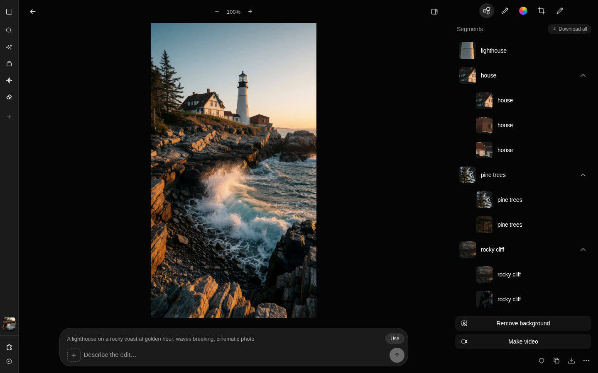
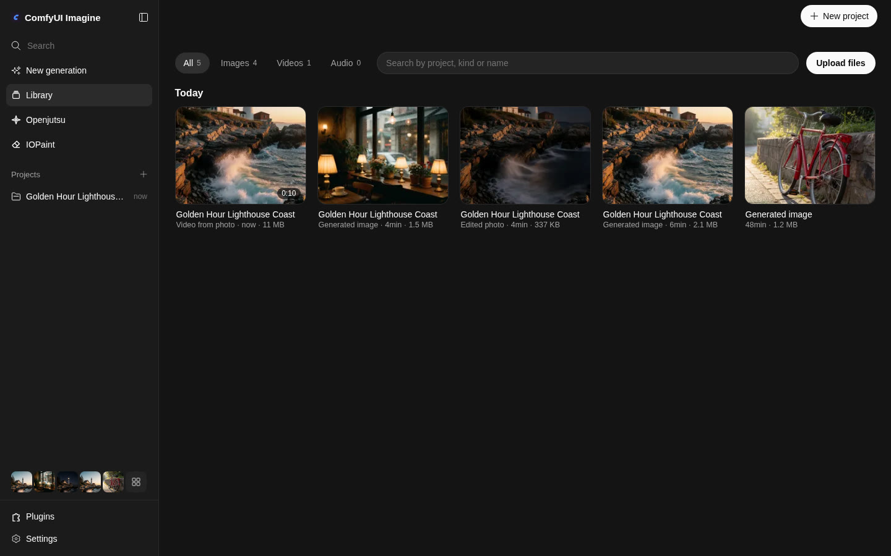

<p align="center">
  
</p>

<h1 align="center">ComfyUI Imagine</h1>

<p align="center">
  A local studio for ComfyUI: describe what you want, get images, edits and videos.
</p>

<p align="center">
  <a href="LICENSE"></a>
  
  
</p>

<p align="center"><sub>An independent project for ComfyUI, not affiliated with or endorsed by Comfy Org.</sub></p>

<p align="center">
  
</p>

A chat that turns a sentence into the right graph, a queue that runs it, a
canvas and a gallery, and a set of ready-made recipes — image to video, object
swap, relighting, animated loops, music, voice, upscaling.

It is a single Node process plus a React interface. It talks to ComfyUI over its
HTTP API and to any OpenAI-compatible chat-completions endpoint for the text and
vision work. Nothing leaves your machine except the calls to the model endpoint
you configure.

The interface is written in English; other languages are installable packs, and
the repository ships Italian (see [Languages](#languages)).

## What it does

- **Chat that drives the graphs.** You describe what you want; the studio picks
  an action, stages the files you dropped in, and asks the text model to write
  the prompt for that specific graph.
- **Recipes, not single nodes.** "Recreate" reads a video with the vision
  model, redraws its opening frame and renders the clip again from it. "Edit
  object" tracks an object in a clip and changes, removes or adds it, window by
  window.
- **A job queue that survives.** Long renders report progress, can be cancelled,
  and a music video left half-made is picked up again after a restart.
- **A photo viewer with tools.** Every picture opens with **Segments** (each
  object found, cut out, ready to edit or download), **Precise edit** with a
  brush, **Colors**, **Draw** and **Crop**, plus one-click remove background,
  make video and upscale.
- **Graphs as configuration.** Every action is an API-format ComfyUI graph plus a
  handful of node ids in `config.yaml`. Swap the model, keep the studio.
- **An MCP server.** `mcp/` exposes the studio's projects, files and jobs as
  typed tools for MCP clients (Claude Code and other agents). It is a separate
  process that talks to the studio only through its HTTP API — see
  [mcp/README.md](mcp/README.md).

## Screenshots

| | |
|---|---|
|  |  |
| **Home** — type a request, or pick an action | **Project** — the chat explains each choice; results land on the canvas |
|  |  |
| **Library** — everything you made, by project | **Plugins** — optional features and language packs, installed from the page |

## Supported models

What `config.example.yaml` wires to each action, read from the graphs in
`workflows/`. The file names are the ones the graphs load: put the weights in
the matching ComfyUI folders, or edit the graph to use your own. Any action can
point at another graph — see [The workflows](#the-workflows).

| Action | Model family | Weights the graph loads |
|---|---|---|
| Generate image, redraw a video's first frame | **Krea 2 Turbo** ([Comfy-Org/Krea-2](https://huggingface.co/Comfy-Org/Krea-2)) | `krea2_turbo_int8_convrot`, text encoder `qwen3vl_4b_int8_convrot`, VAE `qwen_image_vae` |
| Edit photo, precise edit (brush), reference image | **Krea 2 Turbo** + identity-edit LoRA | the three above + `krea2_identity_edit_v1_2` (LoRA) |
| Compose a person with a reference (costume, setting) | **Qwen-Image 2.1** | `qwen_image_2.1_int8_convrot`, `qwen3vl_8b_int8_convrot`, `qwen_image_2.1_vae_bf16` |
| Relight a photo | **FLUX.3 Klein** | `flux3-image-klein-int8-convrot`, `qwen3vl_4b_nvfp4`, `flux2-vae` |
| Make video, loop, extend, video on a song, recreate video | **MiniMax H3** (fast and quality graphs) | `minimax_h3_fl2va` / `minimax_h3_ref2va` (int8), text encoder `qwen3vl_32b_minimax_h3_nvfp4_awq`, video and audio VAEs, Pika H3 Flex turbo LoRAs |
| Edit object in a video: change, remove, background, add | **MiniMax H3** + **SAM 3.1** | the H3 weights + `minimax_h3_character_swap_v1.1` LoRA, `sam3.1_multiplex_fp16` |
| Regenerate detail (video at 1.5×) | **MiniMax H3** | latent upscaler 3D + `minimax_h3_open_regenerate_2k` LoRA |
| Segments (objects in a photo) | **SAM 3.1** + the vision model | `sam3.1_multiplex_fp16`, node in [comfyui-nodes/imagine-segments](comfyui-nodes/imagine-segments) |
| Upscale photo / video | **SeedVR2** | `seedvr2_ema_7b_sharp_fp16` (photo), `seedvr2_3b_int8_convrot` (video), `ema_vae_fp16` |
| Remove background | **BiRefNet** | `birefnet` |
| Music | **MiniMax Music 3** | `minimax_music3_dit_fp16`, its text encoder and `minimax_music3_dav` |
| Change voice / extract vocals | **RVC** / **MelBand RoFormer** | your `voice-model.pth`; `MelBandRoformer_fp16` |
| Remove object (photo) | **LaMa** in IOPaint | through the IOPaint plugin, outside ComfyUI |

**Text and vision** go to any OpenAI-compatible chat-completions endpoint
(Ollama, vLLM, LM Studio, llama.cpp, a hosted API): the model writes the
prompts, reads photos and frames, and names projects. One with image input is
recommended — Segments, Recreate and the photo descriptions need it.

## Requirements

- Node 24 or newer (`package.json` declares `"engines": { "node": ">=24" }`).
- `git`, to get the code and to update it.
- `ffmpeg` and `ffprobe` on the `PATH`: thumbnails, crops, trims and every
  video step use them (`apt install ffmpeg` on Debian/Ubuntu).
- A reachable ComfyUI, with the custom nodes your graphs use.
- An OpenAI-compatible endpoint for text, and ideally one that takes images.
- The checkpoints, VAEs and LoRAs your graphs name. **They are not included.**

## Install

```sh
git clone https://github.com/BTekV4/comfyui-imagine.git
cd comfyui-imagine
npm install
cp config.example.yaml config.yaml     # then edit it: ComfyUI's address, your model endpoint
npm run build
node dist/server.mjs
```

To keep it running, `deploy/imagine.service` is a systemd unit to copy (it
assumes the app in `/opt/imagine`; keys go in `/opt/imagine/imagine.env`).

To update: `git pull`, `npm install`, `npm run build`, restart. The plugins you
installed are brought up to the new version at the next start (the old files
stay beside them as `*.bak-<time>-update`; their settings are never touched).

`npm run build` runs `scripts/build.mjs`, which bundles the server
(`dist/server.mjs`), the MCP server (`dist/imagine-mcp.mjs`) and the TypeScript
plugins (`plugins/<id>/index.mjs`) with esbuild, then `vite build web` builds
the page into `dist/web`. Each part also builds alone: `npm run build:server`,
`build:mcp`, `build:plugins`, `build:web`. `npm test` runs the test suite.

Open `http://localhost:3090`.

**There is no login until you turn it on.** Whoever reaches the address gets
in, so on a shared network set a password in **Settings → Access** and switch on
**Ask for the password**. It works over plain `http://` too; behind an HTTPS
reverse proxy the login cookie is also marked `Secure` (the proxy must send
`X-Forwarded-Proto`, as nginx and Nginx Proxy Manager do).

The files live in two places:

| Where | What |
|---|---|
| Paths in `config.yaml`, read relative to that file (`./data/…` in the example) | the media the studio makes (`toolComfy.outputDir`), the password hash (`passwordFile`) and the cookie secret (`secretFile`) |
| `<data>`: `$IMAGINE_HOME`, or `~/.imagine` when the variable is not set | projects, likes and tags, thumbnails, installed plugins and language packs, custom workflows, custom covers, and the settings the page writes |

Back up both. Pointing `toolComfy.outputDir` inside `<data>` keeps everything
in one folder.

## Configuration

Everything deployment-specific lives in `config.yaml` — no address, path or
model name is compiled into the code, and every path in it is read relative to
the file itself.

| Key | What it is |
|---|---|
| `providers` / `models` | One entry per OpenAI-shaped endpoint and the models it serves. `vision: true` marks the ones that can read a frame. |
| `comfy.baseURL` | Where ComfyUI listens. |
| `toolComfy.workflows` | One entry per action: the graph file, the output extension, and the ids of the nodes carrying the prompt, seed, canvas or input image. An entry you leave out disables that action. |
| `toolComfy.persona.path` | Who the prompts describe. See below. |
| `toolComfy.tts` | The speech endpoint for the `speak` action. |

### The persona

Every prompt that has to show a person starts with the same paragraph, and that
paragraph is data: a JSON file named by `toolComfy.persona.path`.

```json
{
  "identity": "The subject, a person standing alone in the photograph, photographed from the front in natural light.",
  "hair": ""
}
```

- `identity` — the paragraph prepended to every draw.
- `hair` — a colour to pin in the text, when the source frame keeps winning.
  Empty leaves the text alone.

A deployment without a persona file boots and works: it draws a neutral,
undescribed person.

## The workflows

`workflows/` holds the graphs in ComfyUI's API format — the same JSON you get
from "Save (API format)". `config.example.yaml` wires one of them to every
action, with the node ids that match the shipped files; the others are
alternative recipes for the same actions (FastH3, MiniMax H3), which take the
same pins. [workflows/README.md](workflows/README.md) lists every file, the
config key it serves and what it does. They are examples from one machine: the
model and LoRA names in them are the ones installed there, so adapt them to
your ComfyUI. Change a graph, change the model, or write your own, then update
the pins.

There is no LoRA switching by keyword anywhere: a graph is static, and what
varies at run time is only what the pins address.

## The home covers

The cards on the home page come with covers made with the studio itself, from
invented subjects (`web/public/imagine/`). To use your own, pick an action in
**Settings → Workflows** and choose a file under "Cover for this action" (an
image or a short video), or put files named after the card's key into
`<data>/covers/` (for example `<data>/covers/video.webp`). Your covers live in
the data directory, win over the shipped ones, and updates do not touch them.

## Languages

| Language | Code | How |
|---|---|---|
| English | `en` | built in, the source of every text |
| Italian | `it` | pack shipped in `locales/it.json`, installed from **Plugins → Languages** |

A new language is one JSON file of the same keys — translate as much as you
like, the rest reads English. Packs for more languages are very welcome as
pull requests.

English is the source language: it is compiled into the page and is the
fallback for any key a pack leaves out. Every other language is a pack — one
JSON file — installed at runtime; see
[docs/language-packs.md](docs/language-packs.md). The `locales/` folder holds the
packs this repository ships (Italian, `locales/it.json`); the Plugins page
installs them.

A browser that has never chosen a language starts in the first of its own
languages that the installation has (English, or an installed pack), else in
English. To change the language,
pick one in **Settings → Language** (the choice is kept in a cookie and in the
browser's storage), or open the page with `?lang=en` (any installed code works).

The server writes its own texts (errors, notices composed in the background)
in the language of the page that asked, and otherwise in the installation's base
language: `language:` in `config.yaml`, `en` by default (`it` is the other one
the server speaks).

## Plugins

Extra features are plugins, installed as a folder under `<data>/plugins/<id>/`
with a `manifest.json` and an `index.mjs`. The studio with no plugins is the
studio as described in this file: no route, no section in the settings page, no
timer. A plugin declares its settings in the manifest and the settings page draws
them, so adding one needs no change here.

The base studio has no social side at all: publishing to Instagram and the
Telegram alerts are plugins too, in `plugins/instagram/` and `plugins/telegram/`,
and `plugins/example-webhook/` is the small one to copy. The page **Plugin** in
the rail lists what is installed (with a switch each), what could not load, and
what the repository ships and the data folder does not have — with an Install
button, so installing one needs no terminal.

`plugins/openjutsu/` and `plugins/iopaint/` show two separate web apps inside the
studio (and IOPaint also powers **Remove object**). The apps are not part of this
repository: install and run them on their own, then enter their address in the
plugin's settings. Their READMEs say what each one needs.

`docs/plugin-api.md` is the contract: manifest fields, the `ctx` a plugin is set
up with, routes under `/plugin/<id>/`, the tick and the status, how settings are
stored and validated, and what happens when a plugin is broken. A plugin can be
plain `.mjs` or TypeScript: `npm run build:plugins` bundles `plugins/<id>/src/`
into the `index.mjs` the host loads, inlining the host modules it imports.

## Status

This is a working studio published as-is, not a framework. The graphs are tied to
specific model families (Krea 2 for images, MiniMax H3 for video; Qwen-Image,
FLUX.3 Klein, SeedVR2 and MiniMax Music for single actions) because
that is what the recipes were measured on. Other families work if you write the graph.

## Contributing

Help is welcome — see [CONTRIBUTING.md](CONTRIBUTING.md) for how to run it in
development, the tests, and the few rules the code follows. Bugs and ideas go to
[GitHub issues](https://github.com/BTekV4/comfyui-imagine/issues).

## License

MIT — see `LICENSE`. Portions derive from DeepSeek Harness (MIT); the notice is
in `NOTICE`. The model weights the graphs reference are not distributed here and
carry their own licenses.
